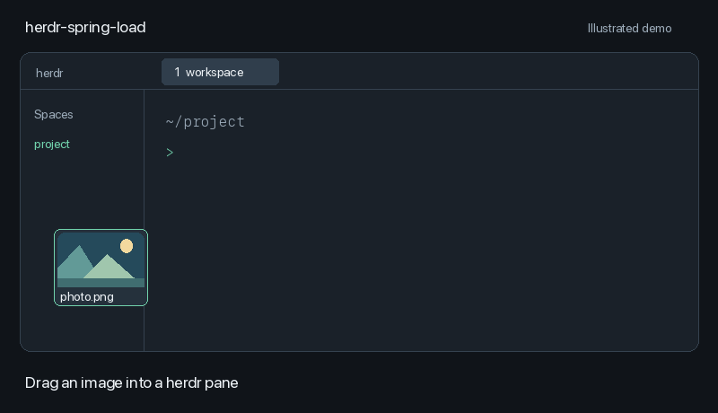

# herdr-spring-load

Spring-loaded drag and drop for herdr on macOS: hover over tabs, panes or
spaces while dragging a file to switch to the destination before releasing it.

*Illustrated demo of spring-loaded navigation.*

## How it works

Like macOS spring-loaded folders, you keep holding the file as you navigate:

1. Drag a file toward herdr and keep the mouse button held down.
2. Pause over a tab to switch to it without releasing the file.
3. Pause over a space in the sidebar to open that workspace.
4. Hover over the destination pane to focus it.
5. Release the mouse button to drop the file into that pane.

The hover opens the destination; releasing the file completes the drop.
You can move through tabs and spaces during the same drag.

## Implementation status

This describes the intended spring-loaded interaction shown above. This
checkout still contains the earlier image-preview implementation; the rename
and this documentation update do not add hover navigation to that code.
The navigation implementation is being developed separately.

Documentation for the existing helper, including its installation and
permissions, is in [Earlier image-preview helper](docs/image-preview-helper.md).

## Demo

The GIF is an illustration, not a screen recording. Regenerate it with
`python3 tools/make_demo.py` (requires Pillow).

## License

MIT, see [LICENSE](LICENSE).
