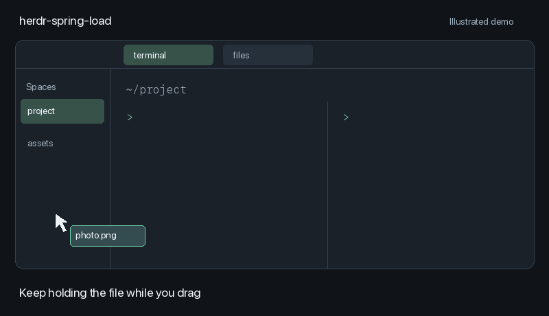

# herdr-spring-load for Ghostty

Spring-loaded Space, tab and pane switching for herdr in **Ghostty on macOS**.
Hold a file over a Space in the sidebar, a herdr tab or a pane to switch to it
before dropping the file.

**Work in progress:** in Terminal.app only pane focus works so far. Warp and
other terminals are not supported at this time. Broader terminal and
operating-system support is in development.

## Current status

| Feature or environment | Status |
|---|---|
| Tab switching in Ghostty on macOS | Working in user testing, including native fullscreen; calibration required |
| Pane focus in Ghostty on macOS | Working in user testing |
| Space switching in Ghostty on macOS | Working in user testing; calibration required, and every Space must fit in the sidebar without scrolling |
| macOS Terminal.app | Pane focus working in user testing; tab and Space switching not working yet |
| Warp and other macOS terminals | Work in progress; not supported |
| Linux and Windows | Experimental implementation and automated tests exist; not supported for everyday use |

Automated tests passing does not mean that real file drags work in every
terminal. The statuses above describe the current user-facing experience.

## Install

Use Ghostty on macOS with herdr 0.9.3, Python 3.11 or newer, and Xcode Command
Line Tools. Then run:

```sh
herdr plugin install qcklex/herdr-spring-load
```

Herdr shows an installation preview and asks for confirmation. Setup compiles
the macOS sensor and installs a per-user background helper that starts at login.
It does not request Accessibility, Automation or Screen Recording access.

The repository and plugin ID remain `herdr-spring-load`; the display name
includes Ghostty to make the current compatibility clear.

## Use it in Ghostty

1. Run herdr alone in a Ghostty window, without Ghostty tabs or splits.
2. Click a different **herdr tab** once, without dragging, to calibrate the
   window. Resizing the window keeps the calibration; repeat it after changing
   the terminal font size or entering native fullscreen.
3. Drag a file from Finder into that window and keep holding the mouse button.
4. Pause over a herdr tab label for about 0.6 seconds to switch tabs, or over a
   pane for about 0.25 seconds to focus it.
5. Release to let Ghostty deliver the file to the focused pane as usual.

Pause over a Space in the sidebar for about 0.6 seconds to open it. This
needs the whole Space list to fit in the window: when the sidebar scrolls,
the helper cannot tell which Space is under the pointer and leaves Spaces off.
Make the window taller, or select the Space normally before dragging.

The plugin changes focus; the terminal handles the drop. It does not open
files or preview images itself.

## Demo illustration



This GIF is an illustration of the intended workflow, not a recording or proof
of the current implementation. Regenerate it with `python3 tools/make_demo.py`
(requires Pillow).

## Limits and troubleshooting

- **One attached client per herdr session.** Herdr 0.9.3 focus calls move every
  attached client. The helper refuses navigation when it detects more than one.
- **Window ambiguity.** Extra terminal tabs, splits, minimised windows or
  same-sized windows can prevent the helper from identifying the visible client.
  A single Kiro shell-integration PTY relay is recognised as one session.
- **Calibration.** Tabs need a normal click on a different herdr tab before
  drag switching can work. In Ghostty a calibration carries over when only
  the window size changes; a font change or native fullscreen needs a new one.
  In native fullscreen the tab row under Ghostty's toolbar strip switches tabs
  but never focuses panes, and the toolbar's window buttons and new-tab edge
  are ignored.
- **Layout uncertainty.** Overflowing tab rows, unknown geometry or config
  changes can disable targets. Sidebar git-state and layout checks can disable
  Space targets, and a Space list that scrolls turns Spaces off.
- **Remote sessions.** `herdr --remote` windows are not supported. Do not attach
  remote or otherwise undetectable clients to a session while dragging.
- **Other drag helpers.** Avoid running another helper that changes focus during
  the same drag, including herdr-drag-to-tab or herdr-focus-pane's drag assist.
- **Cancelled drags.** Cancelling a drag does not undo focus changes already made.

Check the helper from a shell:

```sh
herdr plugin action invoke status --plugin herdr-spring-load
herdr plugin log list --plugin herdr-spring-load --limit 3
```

The status reports whether the helper is running, its last blocking reason,
calibration and any disabled targets. A running helper alone does not prove
that navigation is working.

On macOS, its files are in:

- `~/Library/Application Support/herdr-spring-load`
- `~/Library/Logs/herdr-spring-load.log`

Dwell times can be changed from a checkout with:

```sh
sh scripts/build.sh --tab-dwell-ms 800 --pane-dwell-ms 300
```

## Development and compatibility work

The immediate priorities are tab and Space switching in Terminal.app, then
Warp and other terminals. Linux and Windows support also remains
in development. There is no claim of universal terminal or OS compatibility.

The code contains macOS, Linux and Windows sensors and a shared Python core.
The core models herdr 0.9.3's layout and calls its public focus API. The sensors
observe drags and window/process geometry; the plugin sends no synthetic keys
or clicks.

Experimental coverage includes Linux X11 and classic Windows consoles.
Windows Terminal/ConPTY and Linux Wayland are not currently supported.
Implementation details and constraints are documented in:

- [Architecture](DESIGN.md)
- [Sensor contract](docs/SENSOR.md)
- [Linux sensor](sensors/linux/README.md)
- [Windows sensor](sensors/windows/README.md)

These documents describe implementation and test coverage; the current-status
table above is the compatibility guide for users.

## Tests

```sh
python3 -m unittest discover -s tests
```

The latest local suite ran 243 tests with one opt-in integration test skipped.
CI also exercises macOS, Ubuntu and Windows. Tests cover sensor contracts,
geometry, calibration, focus selection and installation rollback. They do not
establish support for real file drags in every terminal.

To run the isolated Herdr integration check on macOS:

```sh
HERDR_TEST_ISOLATED=1 python3 -m unittest discover -s tests -p test_isolated_herdr.py -v
```

This uses a throwaway session and scripted drag events. The latest local check
also had an intermittent final paste-delivery failure before passing on rerun;
manual end-to-end verification remains necessary.

## Uninstall

Remove the helper before uninstalling the plugin:

```sh
herdr plugin action invoke remove-helper --plugin herdr-spring-load
herdr plugin uninstall herdr-spring-load
```

The helper removal stops its login service and removes the sensor, core,
calibration and status files. macOS log files are retained.

## License

MIT. See [LICENSE](LICENSE).
